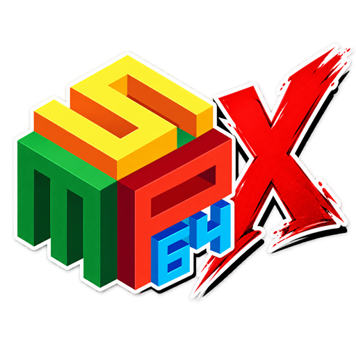

  

# simple64X

simple64X is a Windows fork of [simple64](https://github.com/simple64/simple64), the N64 emulator built on mupen64plus, with a game library, per-game settings, controller assignment and live Pak swapping.

**Download:** the latest zip from [Releases](../../releases). Unzip anywhere and run `simple64X.exe`. No games or system files are included.

## Features

### Game Library and Settings

* Integrated ROM library with folder scanning, search filtering, and double-click launching.
* Retained File > Open ROM for games outside the library.
* Added separate box-art folder selection with filename-based image matching and setup tooltips.
* Enlarged box art and improved game-name and player-count readability.
* Added maximum-player counts with alternate regional-title matching.
* Added right-click access to per-game settings.
* Added per-game core, video, controller-profile, device, and Pak settings.
* Simplified per-game controls by removing separate override checkboxes.

### Controllers and Paks

* Added persistent physical-controller bindings for individual player slots.
* Added button-press controller assignment and per-profile device preferences.
* Added duplicate-device assignment protection.
* Improved controller reconnection while retaining dedicated slot assignments.
* Added raw SDL joystick button, axis, and hat mappings while preserving rumble support.
* Added an assignable Pak Swap shortcut and quick menu with keyboard, controller, and mouse navigation.
* Added live Pak swapping between Memory, Rumble, Transfer, and None during supported local gameplay.
* Preserved Memory Pak data between swaps and stopped rumble when removing the Rumble Pak.
* Saved Pak selections to per-game settings.
* Added a dedicated GB/GBC cartridge and save-file library.
* Added supported-cartridge filtering, matching `.sav` selection, and cartridge/save validation.
* Improved GB cartridge replacement so failed loads preserve the currently mounted cartridge.
* Added GB Tower compatibility fixes for supported US versions of Pokémon Stadium 1 and 2.
* Preserved VRU handling for Hey You, Pikachu!.

### Video and Compatibility

* Retained ParaLLEl as the default renderer.
* Added GLideN64 + HLE RSP as a per-game alternative.
* Added per-game GLideN64 aspect ratio, automatic or 1×–8× internal resolution, and 2D rendering corrections.
* Added explanatory video-setting tooltips and fullscreen-on-launch controls.
* Added borderless desktop fullscreen without changing the display resolution.
* Preserved the main window’s maximized state after gameplay.
* Fixed Windows/MinGW build compatibility issues.
* Added regression checks for Pak switching, save preservation, controller assignments, and Stadium compatibility.

### Updates

* Update check: a startup pop-up only when a newer release exists (never during a game), Help > Check for Updates, and a Help setting to turn the startup check off.
* `simple64X.exe -v` (or `--version`) prints the version for front ends such as LaunchBox. Verbose logging is now `--verbose`.

The update check makes one HTTPS request to GitHub's releases API when simple64X starts (or when you choose Check for Updates) and sends nothing but the request itself. Turn it off under Help.

## Building

Windows, MSYS2 MinGW-w64 with Qt 6, SDL2, CMake and Ninja. `build.sh` builds every component; the GUI alone builds from `simple64-gui` with CMake and produces `simple64X.exe`. `build-input-native.ps1` builds the input plugin directly.

## License and credits

Licensed under GPL-3.0, as simple64. Thanks to Logan McNaughton (loganmc10) and the simple64 contributors, the mupen64plus team, parallel-rdp, and the GLideN64 team.
